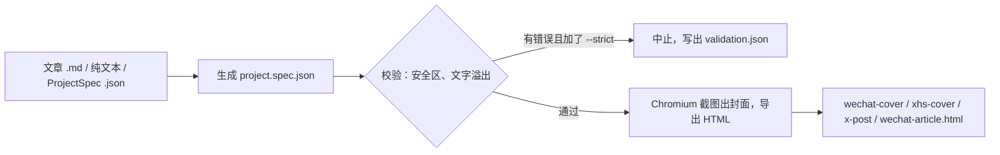

# 🚀 Signal Cover Studio

给 Agent 一篇 Markdown 文章，它一次做出公众号封面、小红书封面、X 配图和公众号 HTML。

<p align="center">
  
</p>

## 🔍 实际效果


上图是用一篇真实文章跑出来的：《穿越时代洪流，积累复利》，作者本人公开发表于 [rzx000.com](https://rzx000.com/writing/compounding-through-the-waves)。输入是 [`docs/demo/compounding-through-the-waves.md`](./docs/demo/compounding-through-the-waves.md)（正文转成 Markdown，去掉了原文的 10 张插图）。第一次用 `--strict` 运行，校验发现自动截取的摘要在公众号和小红书封面上放不下，直接停下、没有出图；按 [`references/troubleshooting.md`](./signal-cover-studio/references/troubleshooting.md) 把 spec 里的摘要改短为「创业两年半，热词换了八轮」后重跑，7 秒得到：

- 三张封面原图：[`wechat-cover.png`](./docs/assets/wechat-cover.png)、[`xhs-cover.png`](./docs/assets/xhs-cover.png)、[`x-post.png`](./docs/assets/x-post.png)。
- 公众号文章 HTML：[`wechat-article.html`](./docs/demo/wechat-article.html)。
- 校验结果：3 张封面全部通过校验，wechat-cover 有警告 hit-min-font-size。
- 看得出的不足：小红书封面的标题在「洪流」中间断行；三张图左上角的小字是平台名（如「微信公众号封面」），没有换成文章自己的内容。

## 📌 状态与限制

- **状态**：渲染程序 `cover-edit` 版本 1.0.0（见 `signal-cover-studio/vendor/cover-edit/package.json`），个人项目；2026-03-20 首次提交，没有 release 和 tag。〔待补：是否持续维护、是否接收 issue 和 PR〕
- **能用在哪**：任何加载 Agent Skills 的 Agent。宿主加载〔待核：在 Claude Code 和 Codex 里各装一次，确认被加载并跑完一次〕。2026-10 起改为通用技能，此前只面向 OpenClaw。
- **不适合**：画插图、照片海报和不带文字的图（请用图像模型）；自由排版。版式固定为「左上标题、右下摘要」，平台只有下面 4 种。
- **依赖**：Node.js、npm，以及 Playwright 的 Chromium 浏览器（几百 MB）。仓库不带 `node_modules`，第一次使用前要自己装，步骤见下一节。脚本层已在 Windows 11、Node 24.15.0、Playwright 1.58.2 上跑通。字体取自系统字体栈（Noto、思源、苹方、微软雅黑等），不加载远程字体；Linux 上需要装 `fonts-noto-cjk`（仓库的字体说明里这样要求），否则缺中文字形。
- **数据去向**：渲染全部在本机完成，代码里没有联网请求，也不需要任何凭据。文件只写进你指定的输出目录（默认 `dist/skill-runs/latest`）。Agent 读文章时，正文会进入你所用模型的上下文。

## 📦 安装

**推荐**：把这句话发给你的 Agent，它会按 [`docs/install.md`](./docs/install.md) 装到正确的位置。

```text
帮我安装 Signal Cover Studio：https://raw.githubusercontent.com/RZX00/signal-cover-studio/main/docs/install.md
```

手动安装共 3 步：

1. 把仓库里的 `signal-cover-studio/` 文件夹整个复制到 Agent 的技能目录。

   | Agent | 技能目录 |
   |---|---|
   | Claude Code | `~/.claude/skills/` |
   | Codex 等读取 `.agents` 的 Agent | `~/.agents/skills/` |

2. 装依赖：

   ```bash
   cd <技能目录>/signal-cover-studio/vendor/cover-edit
   npm install
   ```

3. 下载 Chromium（渲染截图用）：

   ```bash
   npx playwright install chromium
   ```

复制完，`SKILL.md` 应在 `<技能目录>/signal-cover-studio/SKILL.md`。Claude Code 如果是第一次装技能，运行 `/reload-skills`；Codex 会自动发现新技能。

## 🚀 第一次使用

对 Agent 说：

```text
用 signal-cover-studio，把这篇文章做成公众号封面、小红书封面、X 配图和公众号 HTML：~/articles/my-post.md
```

它会：

1. 从文章里取标题（第一个 `#`）、副标题（第一个 `##`）和摘要（没写摘要时取第一段，最多 86 字）；封面左上的小标签取文章开头 frontmatter 里 `keywords` 的前两个，没写就用平台名。
2. 检查每张封面的安全区和文字是否溢出；加了 `--strict` 时，有错误就中止，不出图。
3. 渲染并写出下面 4 个文件，另有 `project.spec.json`、`validation.json`、`manifest.json` 三个记录文件。

| 文件 | 尺寸 | 用途 |
|---|---|---|
| `wechat-cover.png` | 900 × 383 | 公众号封面 |
| `xhs-cover.png` | 1200 × 1600 | 小红书封面 |
| `x-post.png` | 1600 × 1200 | X 配图 |
| `wechat-article.html` | 不适用 | 公众号文章 HTML，样式内联 |

尺寸取自 [`platforms.js`](./signal-cover-studio/vendor/cover-edit/src/lib/platforms.js)，截图缩放比固定为 1，输出就是上表像素，没有 2K 或 2x 选项。已用实际生成的文件核对，像素与上表一致。

<details>
<summary>不经过 Agent，直接跑命令</summary>

在技能目录里运行，路径相对你当前所在的目录：

```bash
cd <技能目录>/signal-cover-studio
node scripts/run_cover_workflow.mjs \
  --source <你的文章.md> \
  --out-dir ./out \
  --strict
```

用仓库自带的示例稿试跑：

```bash
node scripts/run_cover_workflow.mjs \
  --source vendor/cover-edit/examples/content/fundraising.md \
  --out-dir ./out \
  --strict
```

`--strict` 表示校验有错误就不出图。浏览器启动失败，通常是还没执行第 3 步的 `npx playwright install chromium`。

</details>

## 🆚 什么时候用它，什么时候别用

| 你要的 | 用本技能 | 换别的 |
|---|---|---|
| 一篇文章，同时配公众号、小红书、X 的封面，版式统一 | 一条命令出 3 张封面和 1 份公众号 HTML | |
| 封面上的字必须和文章一字不差 | 文字由 HTML 排版后截图，不是模型画出来的 | |
| 换主题色、换标题字体，版式不动 | 加 `--theme`、`--font-profile` 参数重跑 | |
| 带插画、照片或不带文字的海报 | 做不了 | 用图像模型 |
| 每张封面自由排版 | 做不了，版式固定 | 用设计工具 |

## 🛠️ 能力与工作原理



由两层组成：`signal-cover-studio/` 是给 Agent 读的技能（调用入口和版式规则），`signal-cover-studio/vendor/cover-edit/` 是真正生成图片和 HTML 的 Node 程序，也可以单独用。

### 固定的版式规则

版式规则已定稿，写在 [`cover-layout-rules.md`](./signal-cover-studio/references/cover-layout-rules.md)：

- 两极结构，不是四角平均占位：左上是 `eyebrow + 标题 + 副标题`，右下只放摘要。
- 标题、副标题左对齐，摘要右对齐，右边距等于左边距。
- 标题大，副标题也要明显大，并且比通用模板更贴近标题。
- 小红书和 X 的左上小标签可以比普通小标签更大；公众号封面的标题允许再大一点。
- 默认不要漫画气泡、徽章、点阵、左上横线和其他装饰。
- 裁切、安全区和文字溢出一律按错误处理。

### 可变的部分

骨架固定，风格可变。一次只改一个维度，对比起来最清楚：

| 维度 | 参数 | 可选值 |
|---|---|---|
| 主题色 | `--theme` | `soft-gradient-editorial`（默认）、`dark-green-editorial`、`blue-violet-editorial`、`emerald-editorial`、`rose-editorial`、`amber-night-editorial`、`paper-ink`、`comic-night`（配合 `comic-explainer` 模板） |
| 标题字体 | `--font-profile` | `gradient-cover-cn-en`（无衬线，默认）、`title-serif-cn-en`（衬线）、`title-heavy-sans-cn-en`（粗黑体） |
| 输出哪些 | `--targets` | `wechat-cover`、`wechat-article`、`xhs-cover`、`x-post`，逗号分隔，默认全部 |
| 每个平台的模板 | `--template-map` | 例如 `xhs-cover=editorial-cover,wechat-cover=editorial-minimal` |
| 标题、副标题、摘要 | `--title`、`--subtitle`、`--summary` | 覆盖从文章里取到的值 |
| 题图 | `--hero` | 本地图片路径，只在 `comic-explainer` 模板里使用 |
| 项目名 | `--project-id` | 输出记录里的项目名 |

模板有 `editorial-minimal`、`editorial-cover`、`comic-explainer`、`wechat-article-clean` 四个，适用平台见 [`templates.md`](./signal-cover-studio/references/templates.md)。

### 排查

校验失败或渲染失败，先看输出目录里的 `validation.json`，再看 [`troubleshooting.md`](./signal-cover-studio/references/troubleshooting.md)。常见处理：缩短标题和副标题，或换一个更松的模板。

## 🧯 已知问题

- `signal-cover-studio/vendor/cover-edit/package.json` 的 `test`、`ci` 脚本引用 `tests/` 目录，仓库里没有这个目录，`npm test` 和 `npm run ci` 没有测试可跑。
- `signal-cover-studio/references/cover-layout-rules.md` 里写的 `../../projects/cover-edit` 指向作者本机的原目录，仓库里实际路径是 `signal-cover-studio/vendor/cover-edit/`。
- `vendor/cover-edit/README.md` 和 `vendor/cover-edit/docs/design/` 下的设计笔记仍写着 OpenClaw，其中 `skills/signal-cover-studio/` 路径已不存在。

## 📁 仓库内容

```text
signal-cover-studio/            要安装的技能目录
├── SKILL.md                    给 Agent 读的入口
├── references/                 版式规则、平台尺寸、模板、排错
├── scripts/run_cover_workflow.mjs   一条命令跑完整流程
└── vendor/cover-edit/          渲染程序（Node + Playwright）
signal-cover-studio.skill       技能目录的 zip 打包
docs/install.md                 给 Agent 读的安装说明
docs/demo/                      示例输入
PROMPT_TEMPLATE.txt             安装提示词
```

## 📄 许可证

MIT，详见 [`LICENSE`](./LICENSE)。
