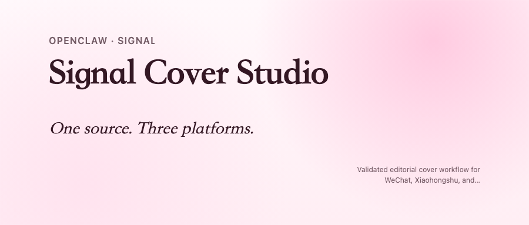

# 🚀 Signal Cover Studio



## 一句话安装

```text
帮我安装 Signal Cover Studio：https://raw.githubusercontent.com/RZX00/signal-cover-studio/main/docs/install.md
```

仓库地址：`RZX00/signal-cover-studio`  
分支：`main`

## ✨ 这是啥

这是一个 **自包含的 OpenClaw / AgentSkill**，用于把一份内容源（Markdown / 纯文本 / 已有 ProjectSpec）打包成统一的多平台内容资产：

- 🟢 微信公众号封面
- 📝 微信文章 HTML
- 📕 小红书封面
- ✖️ X / Twitter 配图

它不是只放了一层 skill 壳。

这个发布仓库里已经把下面这些东西一起带上了：

- 🧠 `signal-cover-studio/` skill 本体
- ⚙️ `vendor/cover-edit/` 运行时
- 📚 `node_modules/` 依赖
- 📦 `.skill` 打包文件
- 📘 安装文档
- ⚖️ MIT License

也就是说，这个仓库分发的是**完整工作流**，不是一个空说明文件。

默认图片输出为 **2K 级别**：最长边至少 `2048px`。

## 🧭 固化下来的最终版规范

这个 skill 默认内置了已经打磨稳定的 editorial cover 规则：

- **两极结构**，不是四角平均占位
- 左上主块：`eyebrow + title + subtitle`
- 右下副块：`summary only`
- title / subtitle 左对齐，summary 右对齐
- **右边距 = 左边距**
- title 大，subtitle 也要明显大，而且更贴近 title
- XHS / X 左上小标签可以比普通 micro-label 更大
- 微信封面标题允许再大一点
- 默认去掉漫画气泡、徽章、点阵、左上横线和杂乱装饰
- clipping / safe-area / overflow 问题直接 hard-fail

## 🎨 风格探索能力

在同一版式骨架下，这个 skill 支持继续探索：

- 🧩 **主题内容**：同结构换不同文案方向
- 🌈 **背景色系**：蓝绿 / 蓝紫 / 碧绿 / 粉色 / 琥珀夜色 / 纸感等
- 🔤 **标题字体**：clean sans / serif editorial / heavy sans

也就是：骨架稳定，风格可变。

## 📦 仓库内容

- `signal-cover-studio/` — 可安装 skill 目录
- `signal-cover-studio.skill` — 打包后的技能文件
- `docs/install.md` — 安装说明
- `PROMPT_TEMPLATE.txt` — 一句话安装提示词

## 🛠️ 手动安装

把 `signal-cover-studio/` 放到以下任一位置：

- `<workspace>/skills/signal-cover-studio`
- `~/.openclaw/skills/signal-cover-studio`

然后开启新的 OpenClaw session。

## ▶️ 运行说明

安装后，典型调用方式：

```bash
node scripts/run_cover_workflow.mjs \
  --source vendor/cover-edit/examples/content/fundraising.md \
  --out-dir dist/skill-runs/platform-cover-demo \
  --strict
```

如果是第一次在一台全新机器上使用，Playwright 浏览器二进制可能仍需手动安装：

```bash
cd signal-cover-studio/vendor/cover-edit
npx playwright install chromium
```

## 📄 License

本项目采用 **MIT License**。
